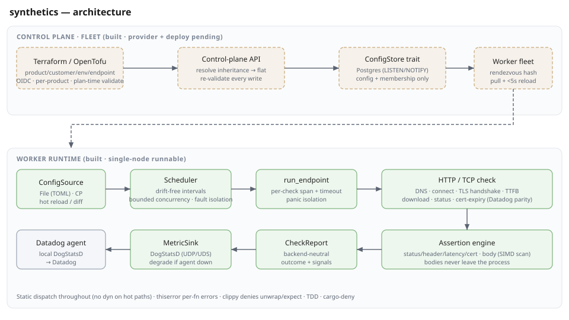

# synthetics

A high-performance, self-hosted replacement for Datadog Synthetics — HTTP and
TCP endpoint monitoring in idiomatic Rust, pushing metrics to a local Datadog
agent (or any swappable sink). Built to run thousands of checks per worker,
reconfigure live without missing a beat, and stay healthy while the things it
monitors are not.



## Why

Datadog charges a premium for simple web-request and TCP-connection checks. This
daemon does the same checks — with full Datadog-parity signals — for the cost of
running a small Rust binary, and emits the results straight to your existing
Datadog agent over DogStatsD.

## What it records (Datadog parity)

Per HTTP check: DNS resolution, TCP connect, TLS handshake, time-to-first-byte,
download, total time, response size, status code, redirect count, and TLS
certificate days-to-expiry. Per TCP check: connect time. Plus per-endpoint
**assertions** — status, header, latency, cert-age, and body checks
(`body_contains` / `body_not_contains` / `body_regex` / `body_sha256`) that catch
"200 OK but the wrong page" (e.g. an nginx default page instead of your login).

Response bodies are asserted **in-process** and never leave it — only low-
cardinality outcomes reach your metrics pipeline (cost + PII guard).

## Design highlights

- **Fault isolation** — a slow, hung, or dead target never delays another
  target's checks. Every check is bounded by a hard timeout; a panic in one
  check becomes a failure metric, never a crash.
- **Live reconfiguration** — reload on `SIGHUP` with no restart and no missed
  check for unchanged endpoints; a bad config is rejected wholesale, the running
  config keeps going.
- **Fast** — async Tokio, bounded concurrency, flat memory under many endpoints,
  and an AVX2 body scan (~140× over scalar, with a scalar fallback everywhere).
- **Swappable everything** — metric sink, config source, and (for the fleet)
  storage all sit behind traits, with static dispatch on the hot paths (no
  `dyn`, no per-emit allocation).
- **Rigorous** — TDD throughout, `thiserror` per-function error enums, clippy
  denies `unwrap`/`expect`, `cargo-deny` gates licenses/advisories, and every
  public item is documented.

## Quickstart

```bash
cargo build --release

cat > synthetics.toml <<'EOF'
[defaults]
interval = "30s"
timeout  = "10s"

[[endpoint]]
id = "web/globex-prod/login"
tags = ["product:web", "customer:globex", "env:prod"]
  [endpoint.http]
  url = "https://globex.example.com/login"
  [[endpoint.assert]]
  type = "status"
  equals = 200
  [[endpoint.assert]]
  type = "body_contains"
  value = "Sign in"
  [[endpoint.assert]]
  type = "body_not_contains"
  value = "Welcome to nginx"

[[endpoint]]
id = "web/globex-prod/db"
interval = "15s"
  [endpoint.tcp]
  host = "db.internal"
  port = 5432
EOF

./target/release/synthetics --config synthetics.toml --log-format pretty
```

Reload after editing the config: `kill -HUP <pid>`. Stop: `SIGTERM` / `Ctrl-C`
(graceful).

### Flags

| Flag | Default | Meaning |
|------|---------|---------|
| `--config` | `synthetics.toml` | Path to the TOML config |
| `--dogstatsd` | `127.0.0.1:8125` | Local Datadog agent DogStatsD address |
| `--log-format` | `json` | `json` (collectors) or `pretty` (dev) |

## Metrics emitted

DogStatsD series under the `synthetics.` namespace, tagged with
`endpoint:<id>`, the endpoint's own tags, and `status:` / `failure:`:
`check.up`, `check.duration_ms`, `http.{dns,connect,tls,ttfb,download}_ms`,
`http.response_bytes`, `http.redirects`, `http.cert_days_to_expiry`,
`tcp.connect_ms`, and `check.assertion` (per assertion, with `result:pass|fail`).

## Development

```bash
cargo nextest run                         # tests
cargo clippy --all-targets -- -D warnings # lints (denies unwrap/expect)
cargo deny check                          # licenses / advisories / sources
cargo bench                               # SIMD vs scalar body scan
cargo doc --no-deps --open                # API docs
```

## Status & roadmap

The **single-node worker is complete and runnable**: config → HTTP/TCP checks →
assertions → DogStatsD, with scheduling, fault isolation, hot reload, and
structured tracing.

The **control plane and fleet** are built: a config hierarchy (product →
customer → environment → endpoint) stored behind a `ConfigStore` trait
(Postgres or in-memory), resolved server-side into flat checks; a writer API
(per-product OIDC scope, field-scoped validation) and a worker API (serve
resolved checks + live worker-set + heartbeat); and workers that shard checks by
rendezvous hash, pull from the control plane, and survive its outage on cached
config. The CP↔worker HTTP contract is in
[`docs/control-plane-api.yaml`](docs/control-plane-api.yaml).

The **deploy stack** is built and verified on a real cluster: a Nix flake builds
both binaries and their OCI images reproducibly; a Helm chart deploys the CP,
the worker fleet, and a CloudNativePG Postgres to KIND (with a local registry),
orchestrated by `just` + Tilt.

Remaining: a local mock Datadog receiver and WebSocket checks.

### Deploy locally

```bash
nix develop          # devshell with the full toolchain
just up              # KIND + registry + CloudNativePG + nix images + Helm deploy
```

This stands up the control plane, a 3-pod worker fleet, and Postgres. Author a
check against the control plane (writer API) and watch a single worker pick it
up by rendezvous ownership. `just down` tears it all down. See `SPEC.md` for the
task list and `docs/` for the API contract and ADRs.
